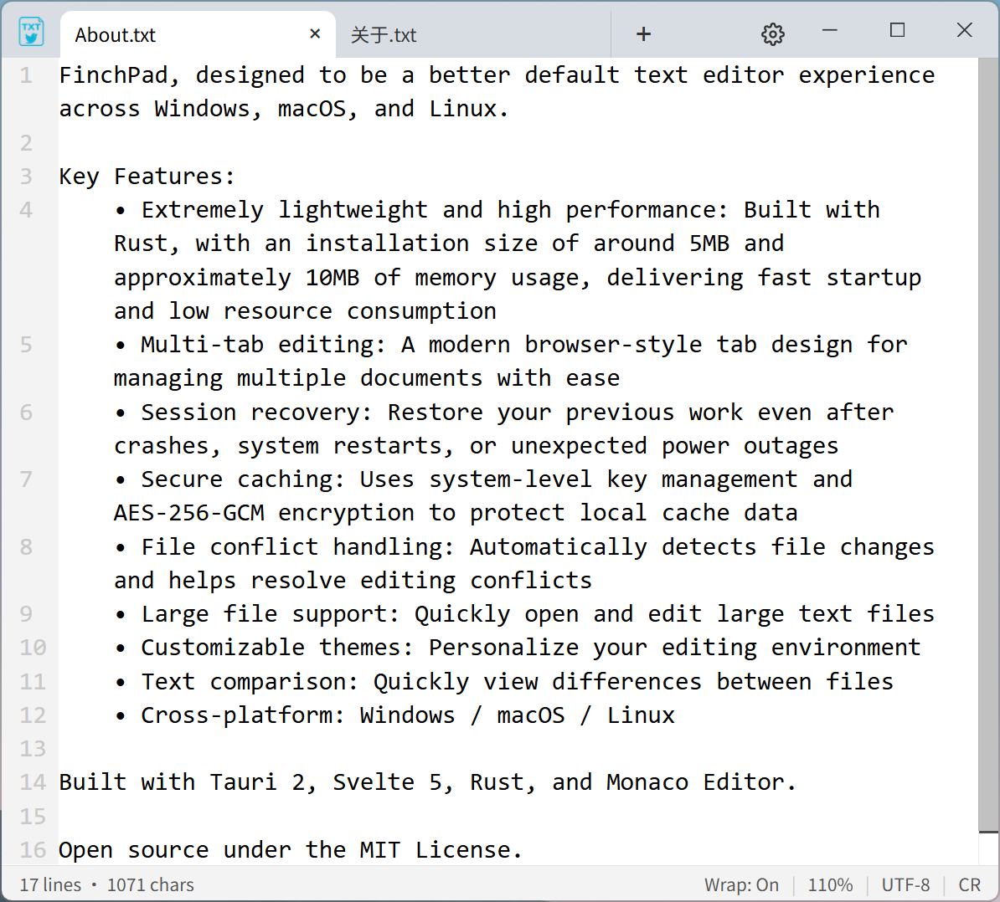
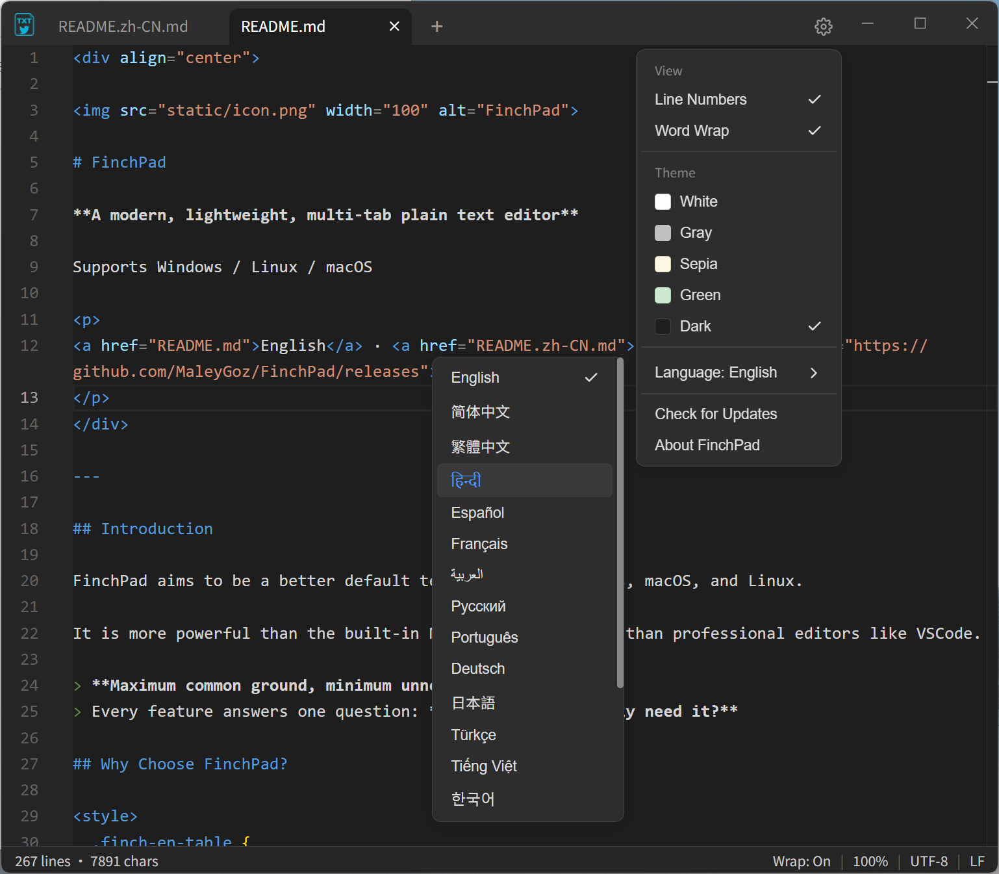
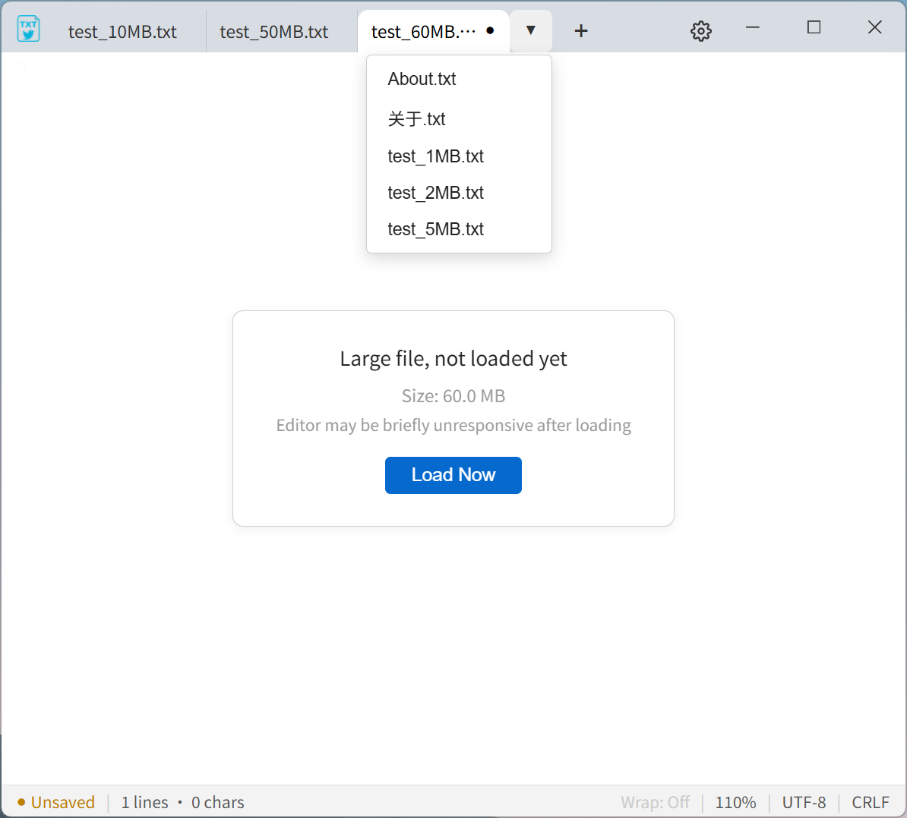

<div align="center">


# FinchPad

**A modern, lightweight, multi-tab plain text editor**

Supports Windows / Linux / macOS

<p>
<a href="README.md">English</a> · <a href="README.zh-CN.md">简体中文</a> · <a href="https://github.com/MaleyGoz/FinchPad/releases">Download</a>
</p>
</div>

---

## Introduction

FinchPad aims to be a better default text editor on Windows, macOS, and Linux.

It is more powerful than the built-in Notepad, yet lighter than professional editors like VSCode.

> **Maximum common ground, minimum unnecessary features.**
> Every feature answers one question: **Do most users really need it?**

## Why Choose FinchPad?

<style>
  .finch-en-table {
    border-collapse: collapse;
    font-size: 14px;
    line-height: 1.45;
    width: 100%;
    min-width: 700px;
    table-layout: auto;
    word-break: normal;
    white-space: nowrap;
  }
  .finch-en-table th,
  .finch-en-table td {
    border: 1px solid #d0d7de;
    padding: 8px 14px;
    text-align: left;
    vertical-align: top;
  }
  .finch-en-table thead tr {
    background-color: #f0f3f6;
  }
  .finch-en-table tbody tr:nth-child(even) {
    background-color: #f9fafb;
  }
  .finch-en-table tbody tr:hover {
    background-color: #e8ecf0;
  }
  .finch-en-table th:first-child,
  .finch-en-table td:first-child {
    font-weight: 650;
    white-space: normal;
    min-width: 170px;
  }
  .finch-en-table td {
    white-space: nowrap;
  }
  .finch-en-table td:first-child {
    white-space: normal;
  }
  @media (max-width: 820px) {
    .finch-en-table td {
      white-space: normal;
    }
  }
</style>

<table class="finch-en-table">
  <thead>
    <tr>
      <th>Feature / Attribute</th>
      <th><strong>FinchPad</strong></th>
      <th>Windows Notepad</th>
      <th>macOS TextEdit</th>
      <th>Linux gedit</th>
      <th>Notepad++</th>
      <th>Sublime Text</th>
    </tr>
  </thead>
  <tbody>
    <tr>
      <td><strong>Cross-platform Support</strong></td>
      <td>✅ <strong>Win / macOS / Linux</strong></td>
      <td>❌ Windows only</td>
      <td>❌ macOS only</td>
      <td>❌ Linux primarily</td>
      <td>❌ Windows only</td>
      <td>✅ Win / macOS / Linux</td>
    </tr>
    <tr>
      <td><strong>Ultra-lightweight (Installer / RAM)</strong></td>
      <td>✅ <strong>~5MB / ~10MB</strong></td>
      <td>✅ Tiny / Low</td>
      <td>✅ Small / Low</td>
      <td>✅ Small / Low</td>
      <td>⚠️ Small / ~30-60MB</td>
      <td>✅ ~80-150MB</td>
    </tr>
    <tr>
      <td><strong>Cold Start Speed</strong></td>
      <td>✅ <strong>Extremely fast (Native)</strong></td>
      <td>✅ Instant</td>
      <td>✅ Extremely fast</td>
      <td>✅ Fast</td>
      <td>✅ &lt;0.5s</td>
      <td>✅ Fast (&lt;1s)</td>
    </tr>
    <tr>
      <td><strong>Modern Tabs</strong></td>
      <td>✅ <strong>Browser-style drag &amp; middle-click close</strong></td>
      <td>⚠️ Basic tabs</td>
      <td>❌ Single window only</td>
      <td>⚠️ Basic tabs</td>
      <td>✅ Mature tabs</td>
      <td>✅ Mature tabs</td>
    </tr>
    <tr>
      <td><strong>Crash/Restart Session Recovery</strong></td>
      <td>✅ <strong>AES-256 encrypted cache, never lose work</strong></td>
      <td>❌ None</td>
      <td>❌ None</td>
      <td>❌ None</td>
      <td>⚠️ Basic, unencrypted</td>
      <td>⚠️ Hot exit recovery</td>
    </tr>
    <tr>
      <td><strong>External Modification Detection</strong></td>
      <td>✅ <strong>Popup on tab activation, prevents overwriting</strong></td>
      <td>❌ None</td>
      <td>❌ None</td>
      <td>❌ None</td>
      <td>⚠️ Manual reload needed</td>
      <td>⚠️ Weak prompts</td>
    </tr>
    <tr>
      <td><strong>Large File Lazy Loading (&gt;50MB)</strong></td>
      <td>✅ <strong>On-demand loading, no UI freeze</strong></td>
      <td>❌ Laggy on large files</td>
      <td>❌ Struggles with large files</td>
      <td>⚠️ Average</td>
      <td>✅ Good capability</td>
      <td>✅ Excellent</td>
    </tr>
    <tr>
      <td><strong>Built-in Text Diff</strong></td>
      <td>✅ <strong>Quickly view differences</strong></td>
      <td>❌ None</td>
      <td>❌ None</td>
      <td>❌ None</td>
      <td>⚠️ Requires plugin</td>
      <td>⚠️ Requires plugin</td>
    </tr>
    <tr>
      <td><strong>Tab Inline Rename (F2)</strong></td>
      <td>✅ <strong>Rename like a file explorer</strong></td>
      <td>❌ None</td>
      <td>❌ None</td>
      <td>❌ None</td>
      <td>❌ None</td>
      <td>❌ None</td>
    </tr>
    <tr>
      <td><strong>Borderless Modern UI</strong></td>
      <td>✅ <strong>Cross-platform consistent custom title bar</strong></td>
      <td>❌ System native</td>
      <td>❌ System native</td>
      <td>❌ System native</td>
      <td>❌ Traditional Win32</td>
      <td>✅ Native elegance</td>
    </tr>
    <tr>
      <td><strong>Price / License</strong></td>
      <td>✅ <strong>Free &amp; Open Source (MIT)</strong></td>
      <td>✅ Built-in</td>
      <td>✅ Built-in</td>
      <td>✅ Free &amp; Open Source</td>
      <td>✅ Free &amp; Open Source</td>
      <td>❌ Paid ($99)</td>
    </tr>
  </tbody>
</table>

## Screenshots

<p align="center">
  
  <br><sub>Main Interface</sub>
</p>

<p align="center">
  
  <br><sub>Dark Theme</sub>
</p>

<p align="center">
  
  <br><sub>Text Diff</sub>
</p>

<p align="center">
  
  <br><sub>Large File Lazy Loading</sub>
</p>

<p align="center">
  
  <br><sub>FinchPad VS Notepad++</sub>
</p>

## Tech Stack

| Module | Technology |
| --- | --- |
| Language | Rust |
| Desktop Framework | Tauri 2 |
| Frontend | SvelteKit 5 |
| Editor Core | Monaco Editor |
| Encoding | encoding_rs + chardetng |
| Encryption | AES-256-GCM (OS keyring on Win/Linux, local file on macOS) |
| Platform | Windows / Linux / macOS |

FinchPad **does not use Electron**, adopting a lightweight native architecture. Built with Tauri 2, Svelte 5, Rust, and Monaco Editor.

## Build

Requires [Rust](https://rustup.rs/) and [Node.js](https://nodejs.org/).

```bash
git clone https://github.com/MaleyGoz/FinchPad.git
cd FinchPad
npm install
npm run tauri build
```

The installer can be found in `src-tauri/target/release/bundle/`.

## Privacy Policy

FinchPad is designed with a **privacy-first, purely local** philosophy:

1. **100% Local Data**: All your text, edits, and cached files are stored locally on your device (encrypted with AES-256-GCM). We **never collect or upload** your file contents, usage habits, or device information.
2. **No Telemetry or Tracking**: The application contains no background telemetry, analytics, or user behavior tracking code.
3. **Network Activities**:
   - An anonymous request is sent to the GitHub API *only* when checking for software updates.
   - When using Markdown/HTML preview, the WebView may load external network resources (e.g., images or links) if your document references them.
   - Aside from the above, FinchPad never initiates network connections.

## Contributing

All forms of participation are welcome: code, UI/UX, testing, documentation, translation, bug reports, and product suggestions.

Even if you are not a developer, you are welcome to discuss product direction in [Issues](https://github.com/MaleyGoz/FinchPad/issues).

## License

This project is licensed under the **MIT License**.

Copyright (c) 2026 MaleyGoz

This means you are free to use, modify, and distribute this project, including for commercial purposes, as long as you retain the original copyright and license notices. For more details, please refer to the [LICENSE](https://license/) file in the project root.

------

<div align="center"> <sub>Built with Rust · Tauri · Svelte · and a focus on simplicity.</sub> </div>
