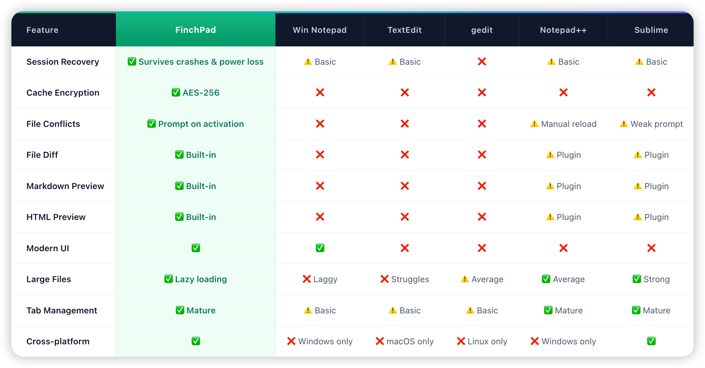
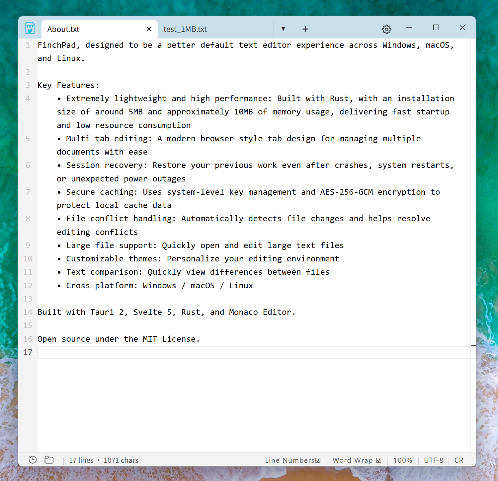
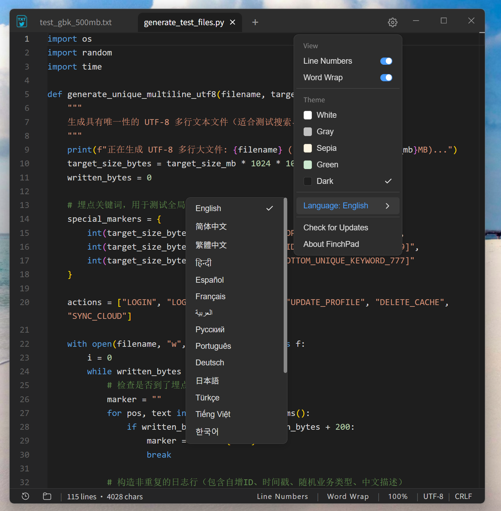
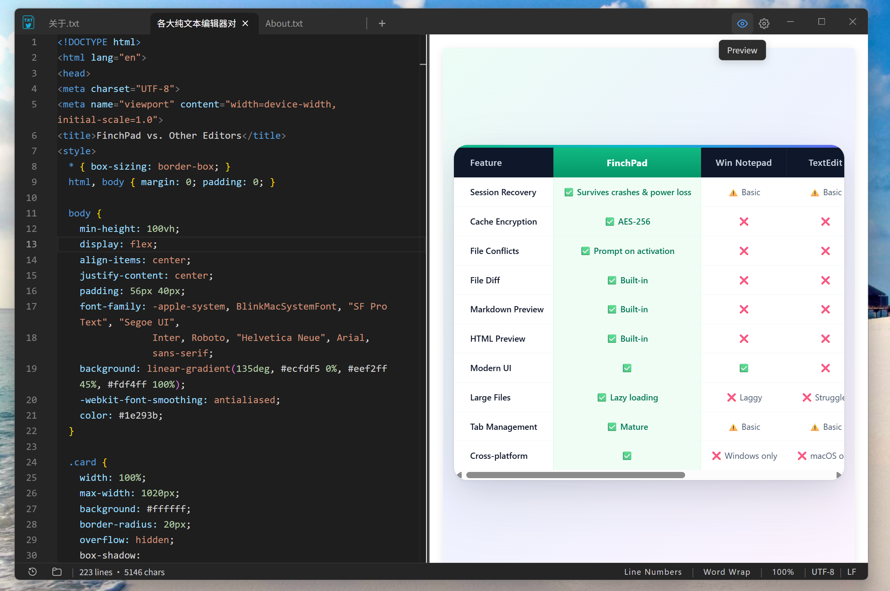
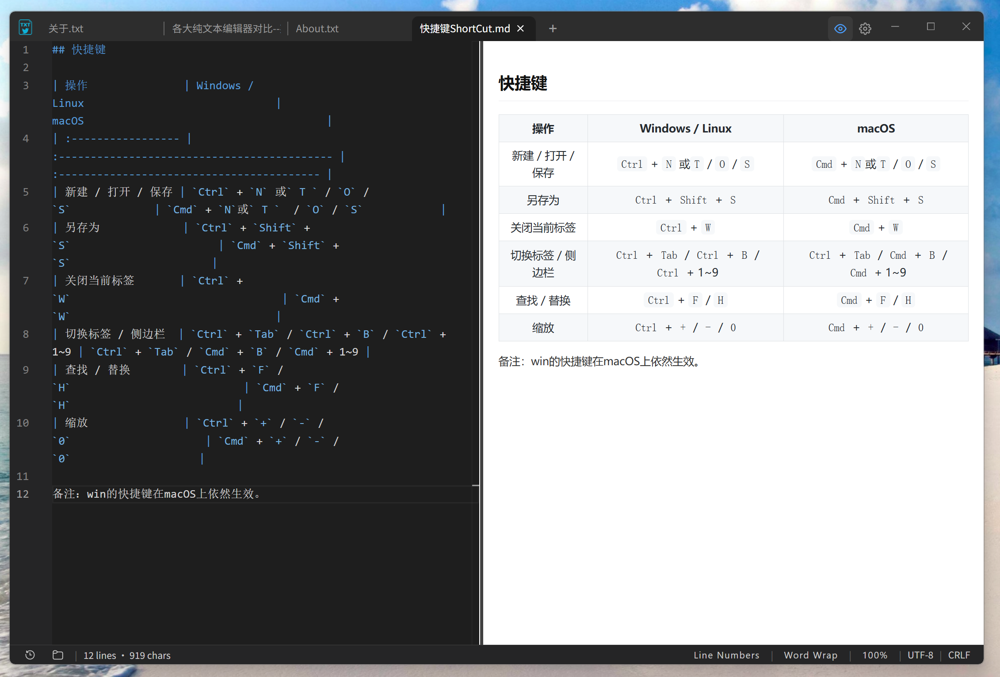
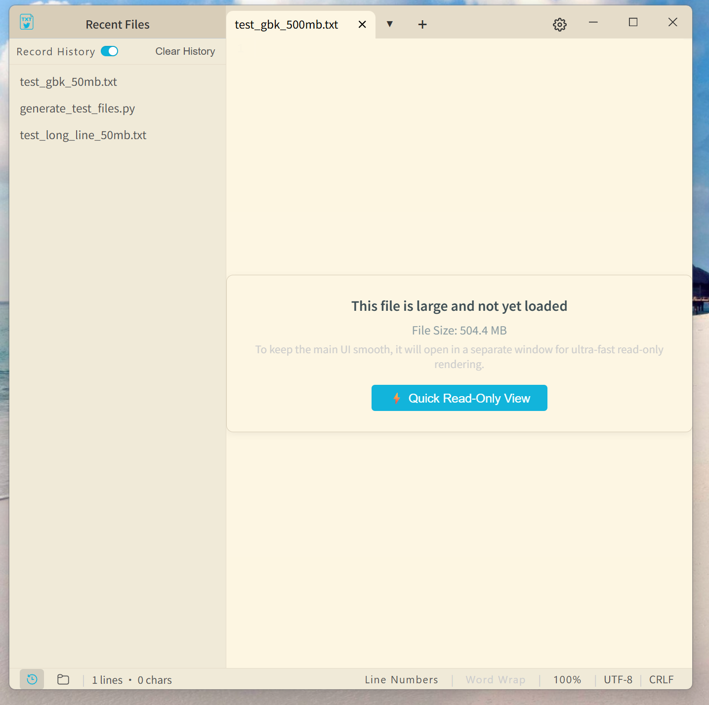
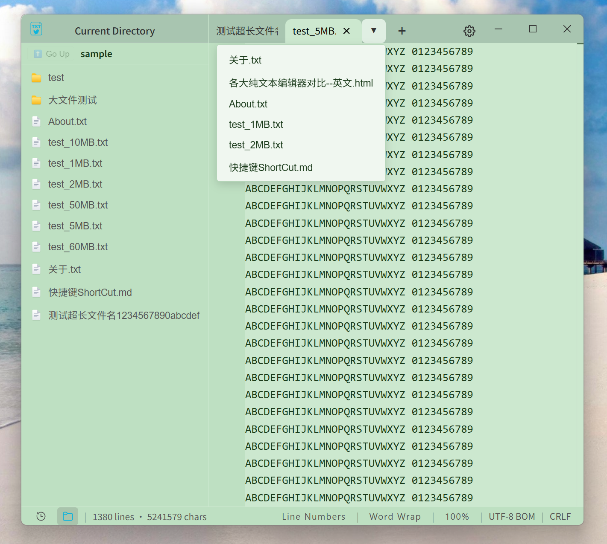
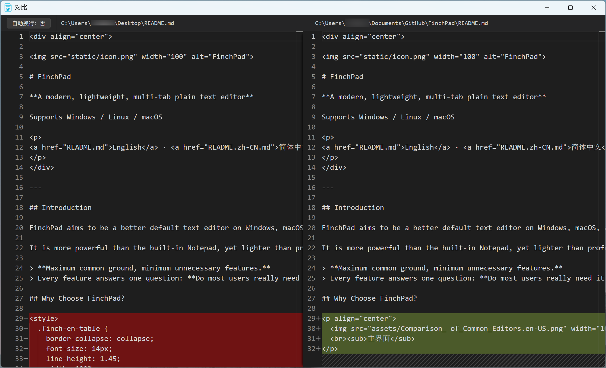
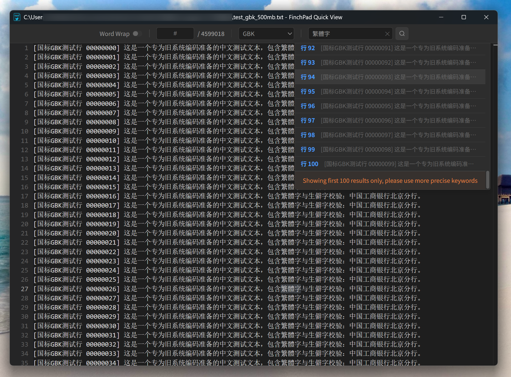

<div align="center">


# FinchPad

**A modern, lightweight, multi-tab plain text editor**

Supports Windows / Linux / macOS

<p>
<a href="README.md">English</a> · <a href="README.zh-CN.md">简体中文</a> · <a href="https://github.com/MaleyGoz/FinchPad/releases">Download</a>
</p>
</div>

---

## Introduction

FinchPad aims to be a better default text editor on Windows, macOS, and Linux.

It is more powerful than the built-in Notepad, yet lighter than professional editors like VSCode.

> **Maximum common ground, minimum unnecessary features.**
> Every feature answers one question: **Do most users really need it?**

## Why Choose FinchPad?

#### Use Cases

FinchPad is not meant to replace heavy IDEs, but to provide the perfect experience when you need something **lightweight, blazing-fast, and ephemeral**:

* 🔐 **Secure Scratchpad & Memo**: Thanks to instant startup and local encrypted caching, whether jotting down inspiration, temporary passwords, or meeting notes, your data is perfectly recovered even after an unexpected crash. Never lose your work.
* 📝 **Everyday Plain Text Editing**: A perfect replacement for the default system notepad. Distraction-free, multi-tab supported, focused purely on text.
* 💻 **Quick Code & Script Editing**: Supports syntax highlighting and code folding for 80+ languages. When you need to quickly tweak a Python script, JSON, or config file without waiting for a heavy IDE to load, FinchPad opens instantly. (For deep development, VS Code is still recommended).
* 📖 **Markdown / HTML Live Preview**: Built-in split-screen live preview. Draft a quick webpage or preview a document effortlessly without opening a browser.
* 📜 **Large Log File Viewer**: For massive logs ranging from tens of MBs to GBs, skip the loading screen. Our upcoming standalone ultra-fast viewer will provide instant opening and rapid global search.

#### Core Features

FinchPad abandons the bloat of modern software to deliver an ultimate underlying experience:

* 🚀 **Extreme Lightweight & Cross-Platform**: Rejects the bloat of Electron, built on Tauri 2 and native Rust architecture. Small footprint, instantly ready to use, delivering a consistent premium feel across Windows / macOS / Linux.
* 🎨 **Modern & Minimalist UI**: Modern frameless design, multiple eye-friendly themes, and smooth multi-tab management. No unnecessary pop-ups, allowing you to focus purely on your text.
* 🌍 **Full Format Compatibility, Zero Mojibake**: Automatically detects and reads almost all common encodings (UTF-8 / GBK / Big5, etc.) and line endings (LF / CRLF). More importantly, it **absolutely never alters the original file attributes** when saving—reads as-is, saves as-is.
* 🔒 **Absolute Security & Privacy**: 100% local operation, zero telemetry. Unsaved edits are locally cached with AES-256-GCM encryption. Even after an unexpected power outage, your work is perfectly recovered.
* 🧩 **Powerful yet Restrained**: Supports professional features like session restore, external file conflict detection, and text comparison, but firmly refuses to cram in any complex features you don't need.

#### Comparison of Major Editors
<p align="center">
  
</p>

## Screenshots

<p align="center">
  <b>1. Modern & Minimalist UI</b><br>
  <span style="color: gray; font-size: 14px;">Frameless, immersive design that lets you focus purely on text.</span><br><br>
  
</p>

<p align="center">
  <b>2. 5 Eye-Friendly Themes & Multi-Language</b><br>
  <span style="color: gray; font-size: 14px;">Switch seamlessly between Dark, Sepia, Light Green, and more.</span><br><br>
  
</p>

<p align="center">
  <b>3. HTML Live Preview</b><br>
  <span style="color: gray; font-size: 14px;">Split-screen view to see your code changes instantly as you type.</span><br><br>
  
</p>

<p align="center">
  <b>4. Markdown Live Preview</b><br>
  <span style="color: gray; font-size: 14px;">An immersive, WYSIWYG writing experience for your documents.</span><br><br>
  
</p>
<p align="center">
  <b>5. Sidebar: Recent Files & Large File Lazy Loading</b><br>
  <span style="color: gray; font-size: 14px;">Quickly access history and open massive files instantly without lag.</span><br><br>
  
</p>


<p align="center">
  <b>6. Sidebar: Current Directory & Tab Management</b><br>
  <span style="color: gray; font-size: 14px;">Clear folder trees and a smart hidden-tab dropdown to avoid clutter.</span><br><br>
  
</p>

<p align="center">
  <b>7. Text Comparison</b><br>
  <span style="color: gray; font-size: 14px;">Side-by-side diffing to spot changes at a glance.</span><br><br>
  
</p>
<p align="center">
  <b>8. Extreme Lightweight: FinchPad VS Notepad++</b><br>
  <span style="color: gray; font-size: 14px;">More modern UI, smaller footprint, and lower memory usage.</span><br><br>
  
</p>
<p align="center">
  <b>9. Instant Large File Opening: Open Hundreds of GB of Log Files in Seconds</b><br>
  <span style="color: gray; font-size: 14px;">Fast search, jump to specific lines, and change encoding. Editing not supported yet.</span><br><br>
  
</p>

## Shortcuts

| Action | Windows / Linux | macOS |
| :--- | :--- | :--- |
| New / Open / Save | `Ctrl` + `N` or `T` / `O` / `S` | `Cmd` + `N` or `T` / `O` / `S` |
| Save As | `Ctrl` + `Shift` + `S` | `Cmd` + `Shift` + `S` |
| Close Current Tab | `Ctrl` + `W` | `Cmd` + `W` |
| Reopen Closed Tab | `Ctrl` + `Shift` + `T` | `Cmd` + `Shift` + `T` |
| Switch Tab / Sidebar | `Ctrl` + `Tab` / `Ctrl` + `B` / `Ctrl` + `1~9` | `Ctrl` + `Tab` / `Cmd` + `B` / `Cmd` + `1~9` |
| Find / Replace | `Ctrl` + `F` / `H` | `Cmd` + `F` / `H` |
| Zoom | `Ctrl` + `+` / `-` / `0` | `Cmd` + `+` / `-` / `0` |

*Note: Windows shortcuts (using `Ctrl`) also remain fully functional on macOS.*

## Tech Stack

| Module | Technology |
| --- | --- |
| Language | Rust |
| Desktop Framework | Tauri 2 |
| Frontend | SvelteKit 5 |
| Editor Core | Monaco Editor |
| Encoding | encoding_rs + chardetng |
| Encryption | AES-256-GCM (OS keyring on Win/Linux, local file on macOS) |
| Platform | Windows / Linux / macOS |

FinchPad **does not use Electron**, adopting a lightweight native architecture. Built with Tauri 2, Svelte 5, Rust, and Monaco Editor.

## Build

Requirements: [Rust](https://rustup.rs/), [Node.js](https://nodejs.org/) (v18+), and native system build tools (e.g., C++ Build Tools for Windows, Xcode CLT for macOS, WebKitGTK for Linux. See [Tauri Prerequisites](https://tauri.app/start/prerequisites/) for details).

```bash
git clone https://github.com/MaleyGoz/FinchPad.git
cd FinchPad
npm install

# Run in development mode (with hot reload)
npm run tauri dev

# Build production installer
npm run tauri build
```

The installer can be found in `src-tauri/target/release/bundle/`.

## Privacy Policy

FinchPad is designed with a **privacy-first, purely local** philosophy:

1. **100% Local Data**: All your text, edits, and cached files are stored locally on your device (encrypted with AES-256-GCM). We **never collect or upload** your file contents, usage habits, or device information.
2. **No Telemetry or Tracking**: The application contains no background telemetry, analytics, or user behavior tracking code.
3. **Network Activities**:
   - An anonymous request is sent to the GitHub API *only* when checking for software updates.
   - When using Markdown/HTML preview, the WebView may load external network resources (e.g., images or links) if your document references them.
   - Aside from the above, FinchPad never initiates network connections.

## Contributing

All forms of participation are welcome: code, UI/UX, testing, documentation, translation, bug reports, and product suggestions.

Even if you are not a developer, you are welcome to discuss product direction in [Issues](https://github.com/MaleyGoz/FinchPad/issues).

## License

This project is licensed under the **MIT License**.

Copyright (c) 2026 MaleyGoz

This means you are free to use, modify, and distribute this project, including for commercial purposes, as long as you retain the original copyright and license notices. For more details, please refer to the [LICENSE](LICENSE)file in the project root.

------

<div align="center"> <sub>Built with Rust · Tauri · Svelte · and a focus on simplicity.</sub> </div>
