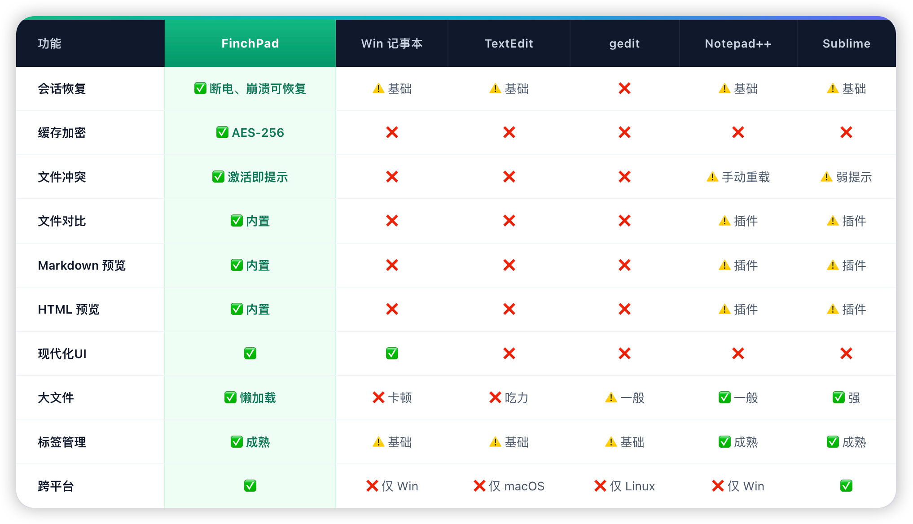
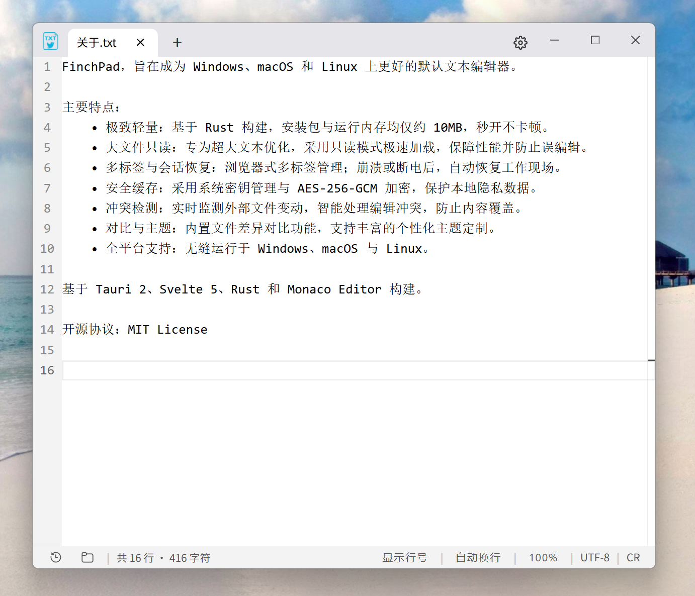
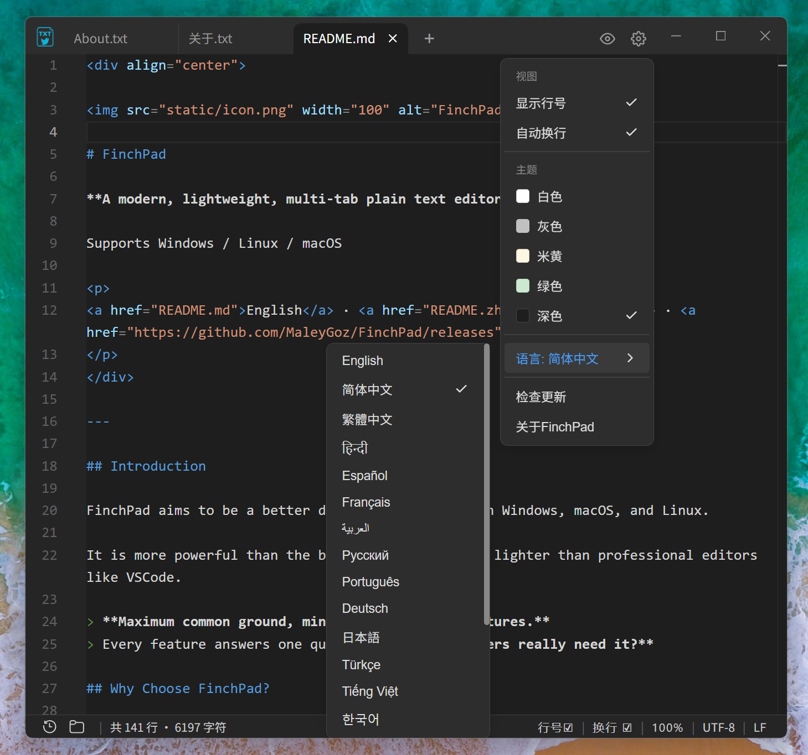
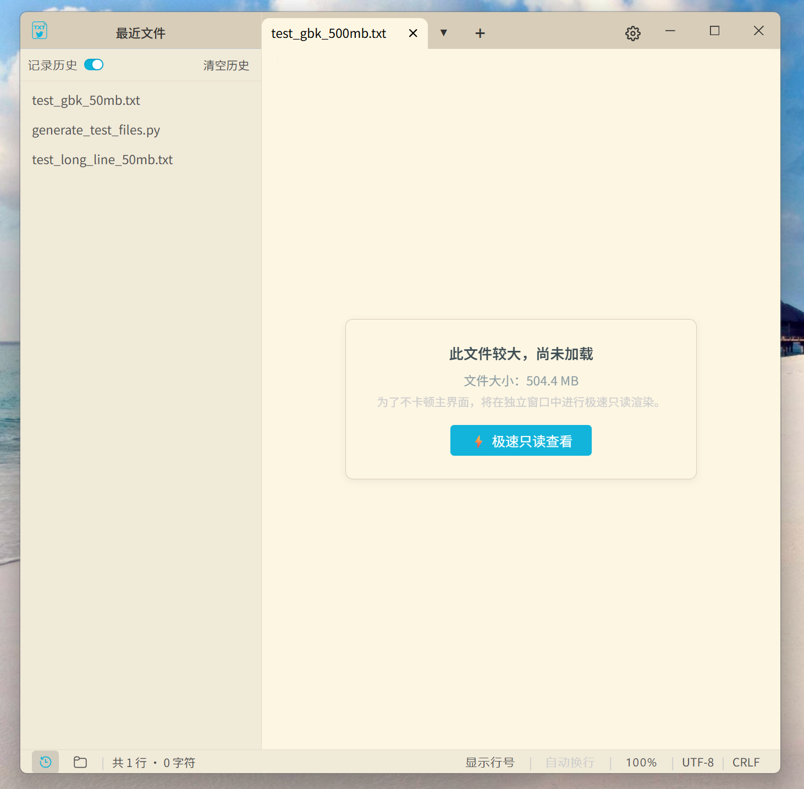
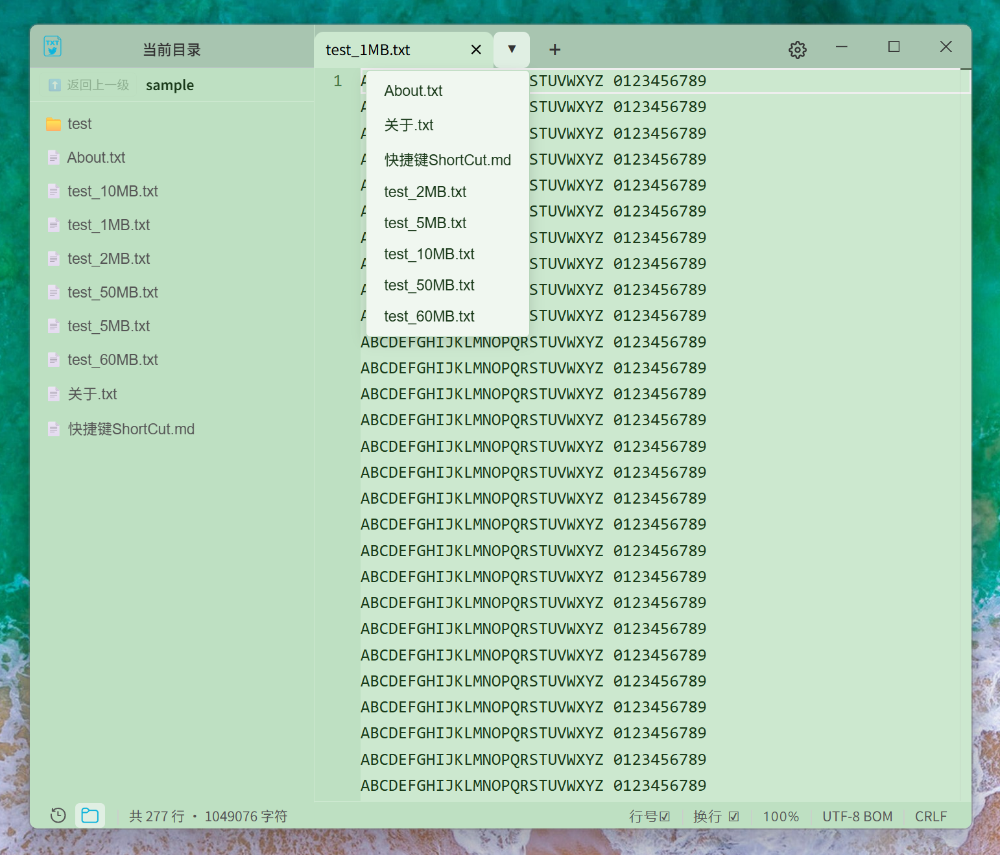
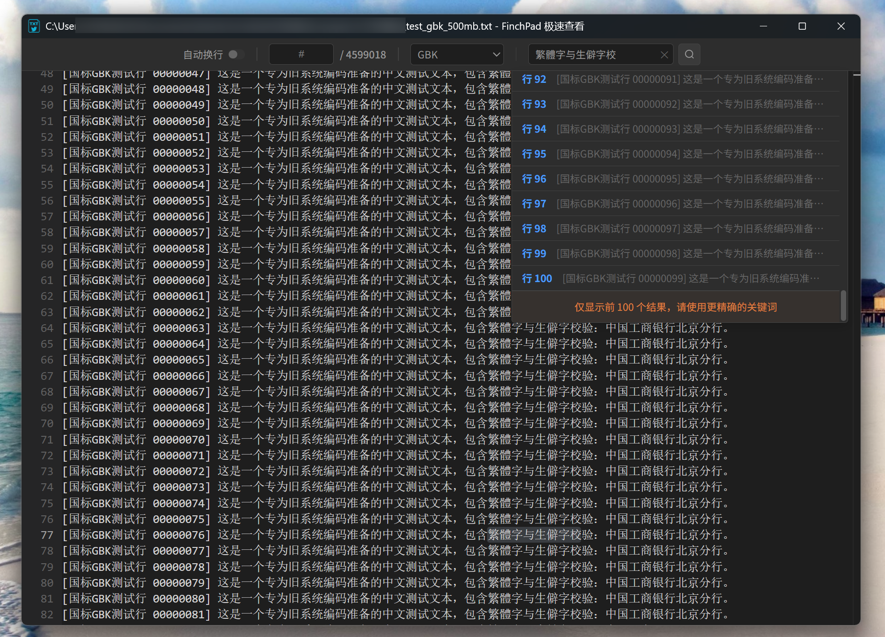

<div align="center">


# FinchPad

**一款现代、轻量化、多标签的纯文本编辑器**

支持 Windows / Linux / macOS

<p>
<a href="README.md">English</a> · <a href="README.zh-CN.md">简体中文</a> · <a href="https://github.com/MaleyGoz/FinchPad/releases">下载</a>
</p>
</div>

---


## 简介

FinchPad 旨在成为 Windows、macOS 和 Linux 上更好的默认文本编辑器。

它比系统自带的记事本更强大，又比 VSCode 等专业编辑器更轻量。

> **最大公约数，最少不必要的功能。**
> 每一个功能都回答一个问题：**大多数用户真的需要它吗？**


## 为什么选择 FinchPad？

#### 适用场景

FinchPad 并非为了取代重度 IDE，而是为了在你需要**轻量、极速、即用即走**时，提供最完美的体验：

* 🔐 **安全备忘录 / 临时记事本**：得益于极速启动和本地加密缓存，无论是记录灵感、临时密码还是会议纪要，哪怕意外死机，重新打开也能完美恢复，数据绝不丢失。
* 📝 **日常纯文本编辑**：作为系统默认记事本的完美替代品，无格式干扰，支持多标签，专注文字记录。
* 💻 **临时代码 / 脚本编辑**：支持 80+ 种语言的语法高亮与折叠。偶尔需要改几行 Python、JSON 或配置文件，不用等笨重的专业 IDE 加载，打开 FinchPad 即改即存（重度开发仍建议使用 VS Code）。
* 📖 **Markdown / HTML 实时预览**：内置分屏实时预览功能，无需打开浏览器，临时编写个网页或预览文档轻松搞定。
* 📜 **超大日志查看**：面对几十 MB 甚至 GB 级的运行日志，无需漫长等待，独立极速查看器将为你提供秒开与快速全局检索的体验。

#### 核心特性

FinchPad 摒弃了现代软件常见的臃肿与复杂，致力于为你提供极致的底层体验：

* 🚀 **极致轻量，跨平台**：拒绝 Electron 的臃肿，基于 Tauri 2 与 Rust 原生架构打造。体积小巧、秒开即用，在 Windows / macOS / Linux 上保持一致的高级感。
* 🎨 **现代极简 UI**：现代化的无边框设计，多款护眼主题与丝滑的多标签管理。没有多余的弹窗干扰，让你专注于文字本身。
* 🌍 **全格式兼容，绝不乱码**：自动识别读取几乎所有常见编码（UTF-8 / GBK / Big5 等）与换行符（LF / CRLF）。更关键的是，保存时**绝对不篡改原文件属性**，原样读入，原样保存。
* 🔒 **绝对安全与隐私**：100% 纯本地运行，零遥测。未保存的编辑内容采用 AES-256-GCM 本地加密缓存，即使意外断电，也能完美恢复。
* 🧩 **强大但克制**：支持会话恢复、外部文件冲突检测、文本对比等专业级功能，但坚决不塞入任何你不需要的复杂功能。

#### 各大编辑器对比
<p align="center">
  
</p>

## 截图

<p align="center">
  <b>1. 现代极简的主界面</b><br>
  <span style="color: gray; font-size: 14px;">无边框沉浸设计，让你专注于文字本身。</span><br><br>
  
</p>

<p align="center">
  <b>2. 5套护眼主题与多语言支持</b><br>
  <span style="color: gray; font-size: 14px;">深色、米黄、浅绿等主题随心切换，界面支持多国语言。</span><br><br>
  
</p>

<p align="center">
  <b>3. HTML 实时预览</b><br>
  <span style="color: gray; font-size: 14px;">左右分屏，边写边看，前端调试的轻量利器。</span><br><br>
  
</p>

<p align="center">
  <b>4. Markdown 实时预览</b><br>
  <span style="color: gray; font-size: 14px;">沉浸式书写，所见即所得的文档编辑体验。</span><br><br>
  
</p>

<p align="center">
  <b>5. 侧边栏：最近文件与大文件懒加载</b><br>
  <span style="color: gray; font-size: 14px;">快速找回历史记录，超大文本也能以占位标签秒开。</span><br><br>
  
</p>

<p align="center">
  <b>6. 侧边栏：当前目录与标签管理</b><br>
  <span style="color: gray; font-size: 14px;">清晰的文件夹树与隐藏标签下拉框，告别多标签混乱。</span><br><br>
  
</p>

<p align="center">
  <b>7. 双向文本对比</b><br>
  <span style="color: gray; font-size: 14px;">并排查看，差异高亮，两版文案一目了然。</span><br><br>
  
</p>

<p align="center">
  <b>8. 极致轻量：FinchPad VS Notepad++</b><br>
  <span style="color: gray; font-size: 14px;">更现代的 UI，更小巧的体积，更少的内存占用。</span><br><br>
  
</p>

<p align="center">
  <b>9. 大文件秒开：数百 GB 超大日志文件，瞬间打开</b><br>
  <span style="color: gray; font-size: 14px;">支持快速搜索、指定行跳转与编码切换，暂不支持编辑</span><br><br>
  
</p>

## 快捷键

| 操作               | Windows / Linux                              | macOS                                      |
| :----------------- | :------------------------------------------- | :----------------------------------------- |
| 新建 / 打开 / 保存 | `Ctrl` + `N`/`T` / `O` / `S`                 | `Cmd` + `N`/`T` / `O` / `S`                |
| 另存为             | `Ctrl` + `Shift` + `S`                       | `Cmd` + `Shift` + `S`                      |
| 关闭当前标签       | `Ctrl` + `W`                                 | `Cmd` + `W`                                |
| 恢复关闭标签       | `Ctrl` + `Shift` + `T`                       | `Cmd` + `Shift` + `T`                      |
| 切换标签 / 侧边栏  | `Ctrl` + `Tab` / `Ctrl` + `B` / `Ctrl` + 1~9 | `Ctrl` + `Tab` / `Cmd` + `B` / `Cmd` + 1~9 |
| 查找 / 替换        | `Ctrl` + `F` / `H`                           | `Cmd` + `F` / `H`                          |
| 缩放               | `Ctrl` + `+` / `-` / `0`                     | `Cmd` + `+` / `-` / `0`                    |

备注：Windows的快捷键在macOS上依然生效。

## 技术架构

| 模块       | 技术                                                        |
| ---------- | ----------------------------------------------------------- |
| 编程语言   | Rust                                                        |
| 桌面框架   | Tauri 2                                                     |
| 前端       | SvelteKit 5                                                 |
| 编辑器内核 | Monaco Editor                                               |
| 编码       | encoding_rs + chardetng                                     |
| 加密       | AES-256-GCM (Win/Linux 基于 OS keyring，macOS 基于本地文件) |
| 平台       | Windows / Linux / macOS                                     |

FinchPad **不使用 Electron**，采用轻量化原生架构。基于 Tauri 2、Svelte 5、Rust 和 Monaco Editor 构建。

## 构建

环境要求：[Rust](https://rustup.rs/)、[Node.js](https://nodejs.org/) (v18+)，以及系统原生构建工具（如 Windows C++ 工具链、macOS Xcode CLT、Linux WebKitGTK，详见 [Tauri 前置要求](https://tauri.app/start/prerequisites/)）。

```bash
git clone https://github.com/MaleyGoz/FinchPad.git
cd FinchPad
npm install

# 本地开发调试 (带热更新)
npm run tauri dev

# 构建生产安装包
npm run tauri build
```

编译产物位于：src-tauri/target/release/bundle/。

## 隐私声明

FinchPad 秉持**绝对隐私、纯本地化**的设计理念：

1. **数据纯本地运行**：你输入的所有文本、编辑记录及缓存文件，均 100% 存储在你的本地设备中（且采用 AES-256-GCM 加密）。我们**绝不收集、不上传**你的任何文件内容、使用习惯或设备信息。
2. **无遥测与追踪**：软件不包含任何后台遥测、数据统计或用户行为追踪代码。
3. **网络请求说明**：
   - 仅在触发“版本更新检查”时，会向 GitHub API 发起匿名请求。
   - 在使用 Markdown / HTML 预览功能时，如果你的文档中包含了外部网络资源（如图片、链接），WebView 可能会自动加载这些外部内容。
   - 除上述情况外，FinchPad 绝不主动发起网络连接。

## 参与贡献

欢迎各种形式的参与：代码、UI/UX、测试、文档、翻译、Bug 报告、产品建议。

即使不是开发者，也欢迎在 [Issues](https://github.com/MaleyGoz/FinchPad/issues) 里讨论产品方向。

## 开源协议

本项目采用 **MIT License** 开源协议。

Copyright (c) 2026 MaleyGoz

这意味着你可以自由地使用、修改、分发本项目，包括用于商业用途，只需保留原始的版权声明和许可声明即可。详细信息请参阅项目根目录下的[LICENSE](LICENSE) 文件。

------

<div align="center"> <sub>Built with Rust · Tauri · Svelte · and a focus on simplicity.</sub> </div> 
