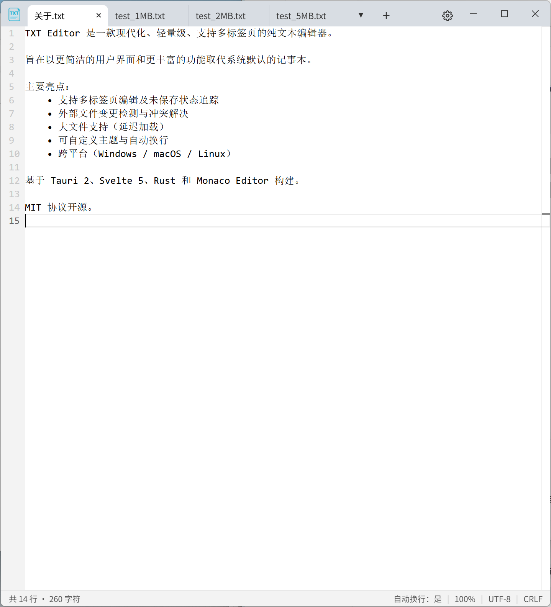
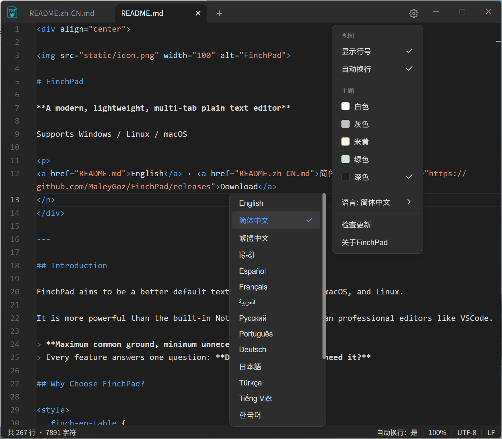
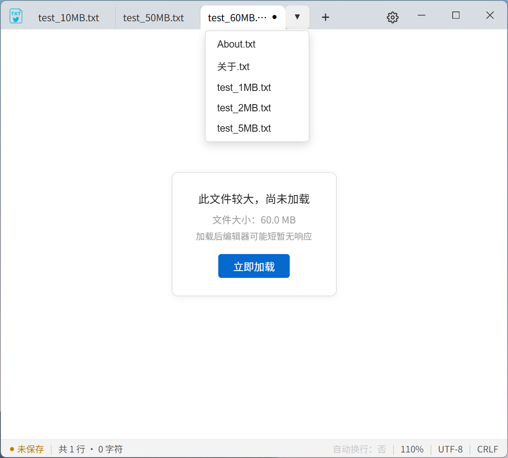

<div align="center">


# FinchPad

**一款现代、轻量化、多标签的纯文本编辑器**

支持 Windows / Linux / macOS

<p>
<a href="README.md">English</a> · <a href="README.zh-CN.md">简体中文</a> · <a href="https://github.com/MaleyGoz/FinchPad/releases">下载</a>
</p>
</div>

---

## 简介

FinchPad 旨在成为 Windows、macOS 和 Linux 上更好的默认文本编辑器。

它比系统自带的记事本更强大，又比 VSCode 等专业编辑器更轻量。

> **最大公约数，最少不必要的功能。**
> 每一个功能都回答一个问题：**大多数用户真的需要它吗？**

## 为什么选择 FinchPad？

<style>
  .finch-table {
    border-collapse: collapse;
    font-size: 13px;
    line-height: 1.4;
    width: 100%;
    min-width: 680px;
    table-layout: auto;
    word-break: normal;
    white-space: nowrap;
  }
  .finch-table th,
  .finch-table td {
    border: 1px solid #d0d7de;
    padding: 8px 12px;
    text-align: left;
    vertical-align: top;
  }
  .finch-table thead tr {
    background-color: #f6f8fa;
  }
  .finch-table tbody tr:nth-child(even) {
    background-color: #fafbfc;
  }
  .finch-table tbody tr:hover {
    background-color: #eaeef2;
  }
  .finch-table th:first-child,
  .finch-table td:first-child {
    font-weight: 600;
    white-space: normal;
    min-width: 160px;
  }
  .finch-table td {
    white-space: nowrap;
  }
  .finch-table td:first-child {
    white-space: normal;
  }
  @media (max-width: 800px) {
    .finch-table td {
      white-space: normal;
    }
  }
</style>

<table class="finch-table">
  <thead>
    <tr>
      <th>功能 / 特性</th>
      <th><strong>FinchPad</strong></th>
      <th>Windows 记事本</th>
      <th>macOS TextEdit</th>
      <th>Linux gedit</th>
      <th>Notepad++</th>
      <th>Sublime Text</th>
    </tr>
  </thead>
  <tbody>
    <tr>
      <td><strong>跨平台支持</strong></td>
      <td>✅ <strong>Win / macOS / Linux</strong></td>
      <td>❌ 仅 Windows</td>
      <td>❌ 仅 macOS</td>
      <td>❌ 主要 Linux</td>
      <td>❌ 仅 Windows</td>
      <td>✅ Win / macOS / Linux</td>
    </tr>
    <tr>
      <td><strong>极致轻量 (安装包/内存)</strong></td>
      <td>✅ <strong>~5MB / ~10MB</strong></td>
      <td>✅ 极小 / 低</td>
      <td>✅ 小 / 低</td>
      <td>✅ 小 / 低</td>
      <td>⚠️ 小 / ~30-60MB</td>
      <td>✅ ~80-150MB</td>
    </tr>
    <tr>
      <td><strong>启动速度 (冷启动)</strong></td>
      <td>✅ <strong>极快 (原生)</strong></td>
      <td>✅ 瞬间</td>
      <td>✅ 极快</td>
      <td>✅ 快</td>
      <td>✅ &lt;0.5s</td>
      <td>✅ 快 (&lt;1s)</td>
    </tr>
    <tr>
      <td><strong>现代多标签页</strong></td>
      <td>✅ <strong>浏览器式拖拽/中键关闭</strong></td>
      <td>⚠️ 基础标签页</td>
      <td>❌ 单窗口单文档</td>
      <td>⚠️ 基础标签页</td>
      <td>✅ 成熟标签页</td>
      <td>✅ 成熟标签页</td>
    </tr>
    <tr>
      <td><strong>崩溃/重启会话恢复</strong></td>
      <td>✅ <strong>AES-256 加密缓存，永不丢稿</strong></td>
      <td>❌ 无</td>
      <td>❌ 无</td>
      <td>❌ 无</td>
      <td>⚠️ 基础恢复，未加密</td>
      <td>⚠️ 热退出恢复</td>
    </tr>
    <tr>
      <td><strong>外部修改实时检测</strong></td>
      <td>✅ <strong>激活标签即弹窗，防覆盖</strong></td>
      <td>❌ 无</td>
      <td>❌ 无</td>
      <td>❌ 无</td>
      <td>⚠️ 需手动重载</td>
      <td>⚠️ 提示较弱</td>
    </tr>
    <tr>
      <td><strong>大文件懒加载 (&gt;50MB)</strong></td>
      <td>✅ <strong>按需加载，不卡 UI</strong></td>
      <td>❌ 大文件卡顿</td>
      <td>❌ 大文件吃力</td>
      <td>⚠️ 一般</td>
      <td>✅ 处理能力强</td>
      <td>✅ 极强</td>
    </tr>
    <tr>
      <td><strong>内置文本对比 (Diff)</strong></td>
      <td>✅ <strong>快速查看差异</strong></td>
      <td>❌ 无</td>
      <td>❌ 无</td>
      <td>❌ 无</td>
      <td>⚠️ 需插件</td>
      <td>⚠️ 需插件</td>
    </tr>
    <tr>
      <td><strong>标签内联重命名 (F2)</strong></td>
      <td>✅ <strong>像资源管理器一样改名</strong></td>
      <td>❌ 无</td>
      <td>❌ 无</td>
      <td>❌ 无</td>
      <td>❌ 无</td>
      <td>❌ 无</td>
    </tr>
    <tr>
      <td><strong>无边框现代 UI</strong></td>
      <td>✅ <strong>跨平台一致的自绘标题栏</strong></td>
      <td>❌ 系统原生</td>
      <td>❌ 系统原生</td>
      <td>❌ 系统原生</td>
      <td>❌ 传统 Win32</td>
      <td>✅ 原生优雅</td>
    </tr>
    <tr>
      <td><strong>价格 / 授权</strong></td>
      <td>✅ <strong>免费开源 (MIT)</strong></td>
      <td>✅ 系统自带</td>
      <td>✅ 系统自带</td>
      <td>✅ 免费开源</td>
      <td>✅ 免费开源</td>
      <td>❌ 收费 ($99)</td>
    </tr>
  </tbody>
</table>

## 截图

<p align="center">
  
  <br><sub>主界面</sub>
</p>

<p align="center">
  
  <br><sub>深色主题</sub>
</p>

<p align="center">
  
  <br><sub>文本对比</sub>
</p>

<p align="center">
  
  <br><sub>大文件懒加载</sub>
</p>

<p align="center">
  
  <br><sub>FinchPad VS Notepad++</sub>
</p>

## 技术架构

| 模块       | 技术                                                        |
| ---------- | ----------------------------------------------------------- |
| 编程语言   | Rust                                                        |
| 桌面框架   | Tauri 2                                                     |
| 前端       | SvelteKit 5                                                 |
| 编辑器内核 | Monaco Editor                                               |
| 编码       | encoding_rs + chardetng                                     |
| 加密       | AES-256-GCM (Win/Linux 基于 OS keyring，macOS 基于本地文件) |
| 平台       | Windows / Linux / macOS                                     |

FinchPad **不使用 Electron**，采用轻量化原生架构。基于 Tauri 2、Svelte 5、Rust 和 Monaco Editor 构建。

## 构建

需要 [Rust](https://rustup.rs/) 和 [Node.js](https://nodejs.org/)。

```bash
git clone https://github.com/MaleyGoz/FinchPad.git
cd FinchPad
npm install
npm run tauri build
```

安装包位于 `src-tauri/target/release/bundle/`。

## 隐私声明

FinchPad 秉持**绝对隐私、纯本地化**的设计理念：

1. **数据纯本地运行**：你输入的所有文本、编辑记录及缓存文件，均 100% 存储在你的本地设备中（且采用 AES-256-GCM 加密）。我们**绝不收集、不上传**你的任何文件内容、使用习惯或设备信息。
2. **无遥测与追踪**：软件不包含任何后台遥测、数据统计或用户行为追踪代码。
3. **网络请求说明**：
   - 仅在触发“版本更新检查”时，会向 GitHub API 发起匿名请求。
   - 在使用 Markdown / HTML 预览功能时，如果你的文档中包含了外部网络资源（如图片、链接），WebView 可能会自动加载这些外部内容。
   - 除上述情况外，FinchPad 绝不主动发起网络连接。

## 参与贡献

欢迎各种形式的参与：代码、UI/UX、测试、文档、翻译、Bug 报告、产品建议。

即使不是开发者，也欢迎在 [Issues](https://github.com/MaleyGoz/FinchPad/issues) 里讨论产品方向。

## 开源协议

本项目采用 **MIT License** 开源协议。

Copyright (c) 2026 MaleyGoz

这意味着你可以自由地使用、修改、分发本项目，包括用于商业用途，只需保留原始的版权声明和许可声明即可。详细信息请参阅项目根目录下的 [LICENSE](https://license/) 文件。

------

<div align="center"> <sub>Built with Rust · Tauri · Svelte · and a focus on simplicity.</sub> </div> 
